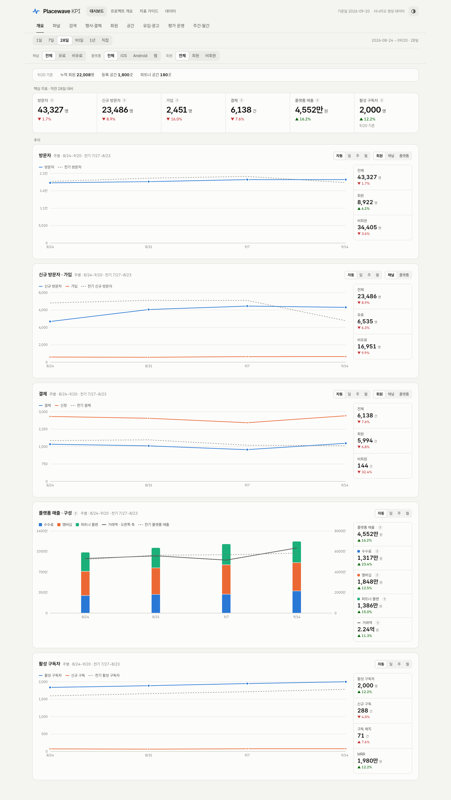
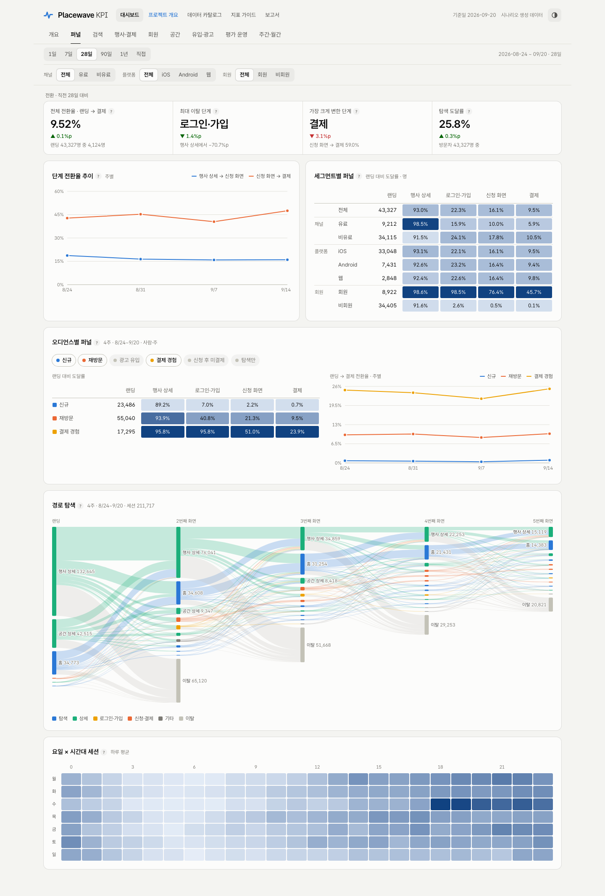
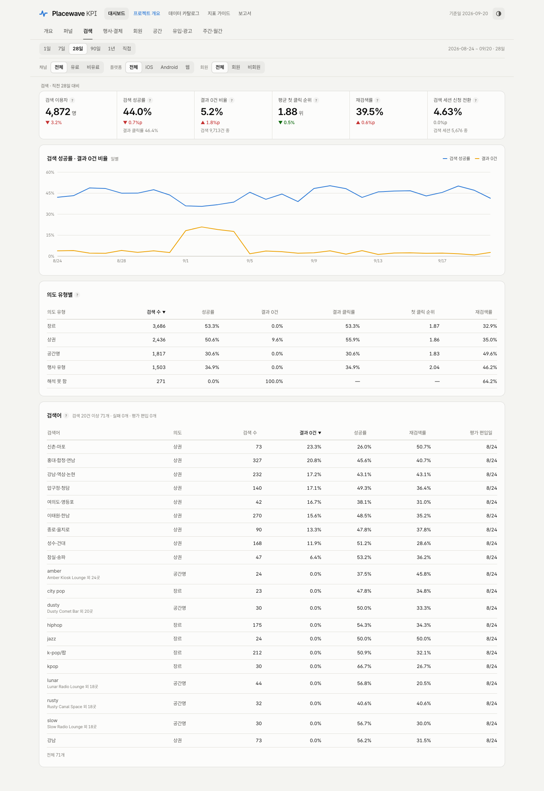
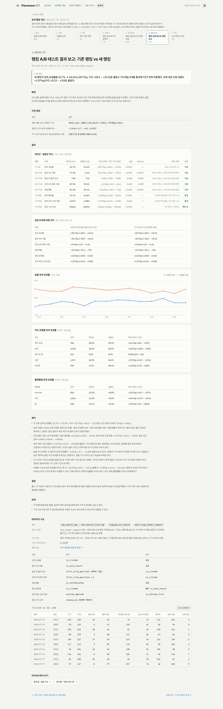
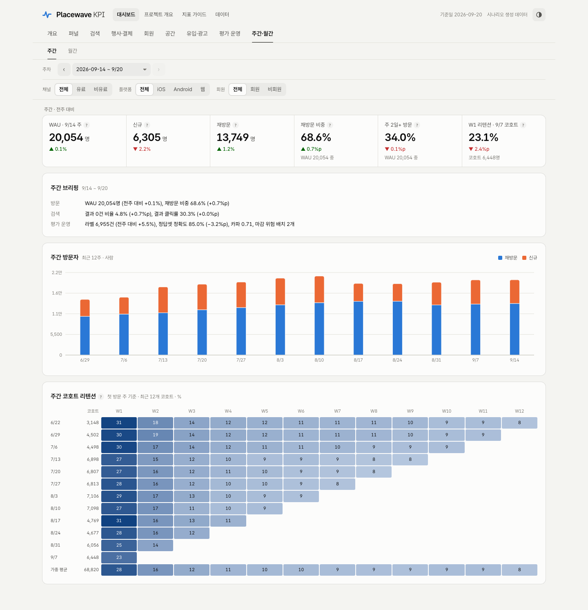
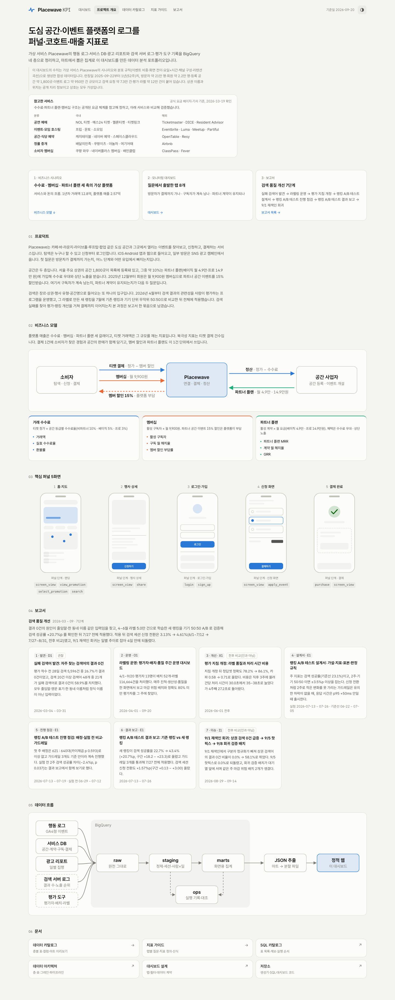
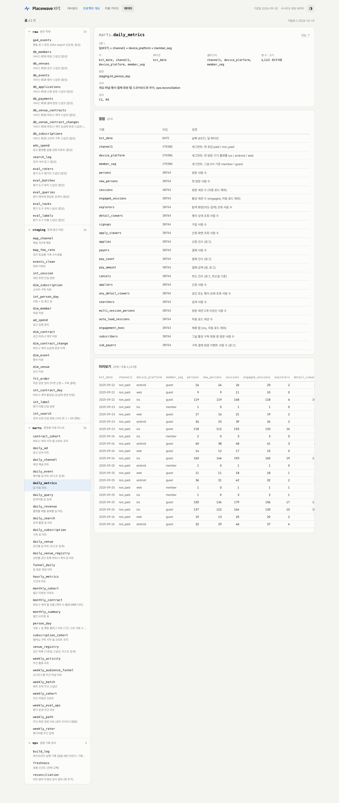
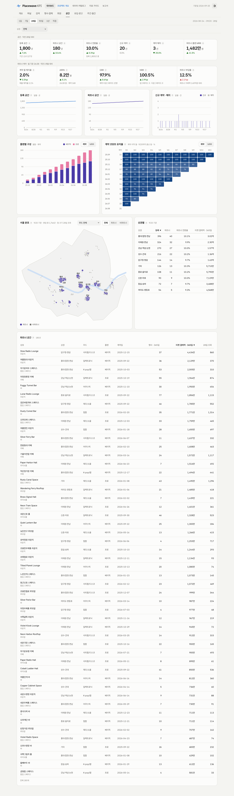
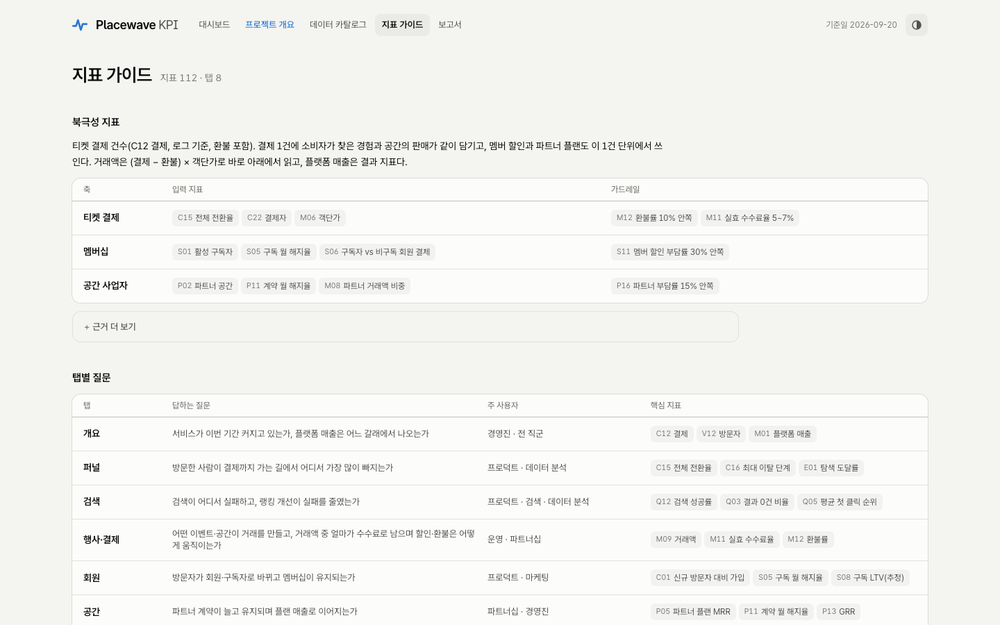
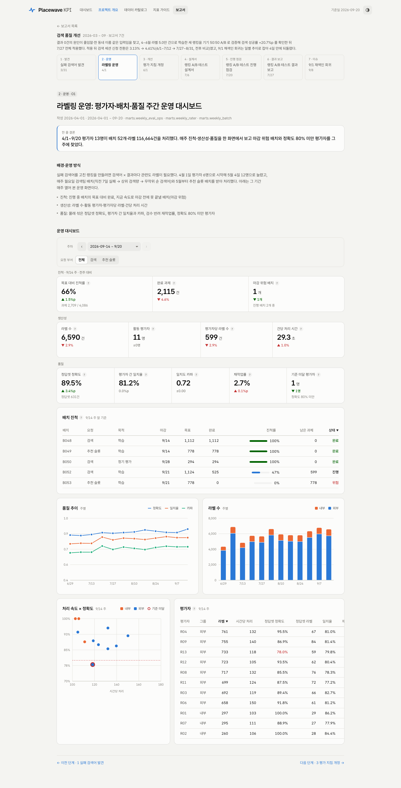

# placewave-analytics

도심 공간·이벤트 탐색 플랫폼 Placewave의 GA4형 행동 로그·서비스 DB 스냅샷·광고 리포트를 BigQuery 네 층(raw → staging → marts → ops)으로 정리하고, 마트에서 뽑은 집계로 퍼널·코호트·광고 KPI 대시보드(정적 웹)를 만든 데이터 분석 포트폴리오.

**이 저장소의 수치는 전부 가상 서비스 시나리오와 분포 규칙으로 생성한 데이터다.** 실제 서비스·회사의 데이터, 코드, 식별자는 들어 있지 않다. 설계는 업무 경험에서 온 일반적인 패턴을 새로 작성한 것이다.

- 대시보드: `https://placewave-analytics.vercel.app`
- 프로젝트 개요: `https://placewave-analytics.vercel.app/?page=about` · 데이터 카탈로그(스키마·미리보기): `https://placewave-analytics.vercel.app/?page=data` · 지표 가이드: `https://placewave-analytics.vercel.app/?page=metrics` · 보고서: `https://placewave-analytics.vercel.app/?page=reports`

## 참고한 서비스

수수료·파트너 플랜·멤버십 구조는 공개된 요금 체계를 참고해 정하고, 아래 국내외 서비스와 비교해 검증했다(공식 요금 페이지·기사 기준, 2026-10-19 확인). 처음 정할 때 쓴 출처는 [docs/business_model.md](docs/business_model.md#출처)에 있다.

| 분류 | 국내 | 해외 |
|---|---|---|
| 공연 예매 | NOL 티켓 · 예스24 티켓 · 멜론티켓 · 티켓링크 | Ticketmaster · DICE · Resident Advisor |
| 이벤트·모임 호스팅 | 프립 · 문토 · 소모임 | Eventbrite · Luma · Meetup · Partiful |
| 공간·식당 예약 | 캐치테이블 · 네이버 예약 · 스페이스클라우드 | OpenTable · Resy |
| 정률 중개 | 배달의민족 · 쿠팡이츠 · 야놀자 · 여기어때 | Airbnb |
| 소비자 멤버십 | 쿠팡 와우 · 네이버플러스 멤버십 · 배민클럽 | ClassPass · Fever |

## 화면

| 개요 | 퍼널 |
|---|---|
|  |  |
| **검색** | **보고서** |
|  |  |
| **주간 코호트** | **프로젝트 개요** |
|  |  |
| **데이터 카탈로그** | **공간** |
|  |  |
| **지표 가이드** | **라벨링 운영 (보고서)** |
|  |  |

탭 8개(개요 / 퍼널 / 검색 / 행사·결제 / 회원 / 공간 / 유입·광고 / 주간·월간)의 모니터링 대시보드, 프로젝트 개요, 데이터 카탈로그, 지표 가이드, 검색 품질 개선을 실패 검색어 발견 → 라벨링 운영 → 평가 지침 개정 → 순위 모델 설계·오프라인 평가 → A/B 설계서 → 진행 점검 → 결과 보고 → 9/1 재색인 회귀 8단계로 읽는 보고서 페이지. 라벨링 운영 대시보드와 실험 구간 표시는 대시보드 탭이 아니라 그 사업의 보고서 안에 둔다. 필터(기간·채널·플랫폼·회원)는 마트에 그 축이 있는 카드에만 붙이고, 상태는 전부 URL에 남는다. 탭별 구성과 산식은 [docs/dashboard.md](docs/dashboard.md).

## 비즈니스 모델

플랫폼 매출은 거래 수수료(티켓 정가 × 공간 등급별 수수료율: 비파트너 10% · 베이직 5% · 프로 3%) · 소비자 멤버십(월 9,900원, 파트너 공간 15% 할인은 플랫폼 부담) · 파트너 플랜(베이직 4.9만 · 프로 14.9만 월) 세 축이고, 티켓 거래액(GMV)은 규모 지표로 따로 본다. 지표 체계·수치 근거는 [docs/business_model.md](docs/business_model.md).

## 북극성 지표

**티켓 결제 건수**(지표 가이드 C12 `결제`, 환불 포함). 결제 1건에 소비자가 찾은 경험과 공간의 판매가 같이 담기고, 멤버 할인·파트너 플랜도 이 단위에서 쓰인다. 거래액은 `(결제 − 환불) × 객단가`로 바로 아래에서 읽고, 플랫폼 매출은 결과 지표다.

- 플랫폼 매출 2.57억 중 거래에 직접 걸리는 몫은 수수료 29.9%이고 나머지 70.1%는 월 구독료라, 매출만 보면 거래 변화가 늦게 보인다.
- 거래액은 가격을 탄다. 12월 → 1월 거래액은 −21.7%였지만 결제 건수는 −1.1%였고, 차이는 객단가(4.8만 → 3.7만)에서 났다.
- 거래가 구독자와 파트너를 붙잡는다. 직전 회차에 파트너 티켓을 산 구독자의 해지율은 안 산 구독자의 0.53배, 판매 하위 1/3 파트너의 계약 해지율은 상위 1/3의 2.25배다.

| 축 | 입력 지표 | 가드레일 |
|---|---|---|
| 티켓 결제 | 전체 전환율 · 결제자 · 객단가 | 환불률 10% 안쪽 · 실효 수수료율 5~7% |
| 멤버십 | 활성 구독자 · 구독 월 해지율 · 구독자 결제율 | 멤버 할인 부담률 30% 안쪽 |
| 공간 사업자 | 파트너 공간 · 계약 월 해지율 · 파트너 거래액 비중 | 파트너 부담률 15% 안쪽 |

한계: 이용·판매와 해지의 연결은 시나리오에 넣은 가정이라, 이 데이터가 보여 주는 것은 그 관계가 원천에서 화면까지 왜곡 없이 전달된다는 데까지다. 근거·고르지 않은 후보·출처는 [지표 가이드](https://placewave-analytics.vercel.app/?page=metrics)와 [docs/business_model.md](docs/business_model.md#0-북극성-지표--티켓-결제-건수)에 있다(a16z · Amplitude · Eventbrite 10-K).

## 시나리오 2.0

런칭 1년차(2025-09-22~2026-09-20) 서울 공간·이벤트 플랫폼. 1.0(탐색 → 신청 → 결제)에 **공간 등록·파트너 계약(B2B)**, **소비자 구독**, **실제 서울 상권 좌표** 축을 더했다. 상권 이름·구·중심 좌표는 공개 지리 정보이고, 상호·행사·회원·매출은 전부 가상 분포로 생성한다. 설계 근거는 [docs/scenario_v2.md](docs/scenario_v2.md).

**시나리오 3.0** 은 같은 세계에 검색 품질과 관련성 평가 운영을 더한다. 검색 엔진 모델(입력 변형 → 랭킹 버전별 해석·정렬 → 위치·관련도 클릭 모델)이 행동 로그와 같은 실행에서 요청마다 서버 로그·클릭 로그를 남기고, 클릭하면 공간·행사 상세로, 결과가 없으면 재검색·이탈로 이어져 신청·결제까지 닿는다. 평가 도구 스냅샷은 그 서버 로그를 읽어 만든다. 검색 실패 → 평가 데이터셋 → 랭킹 v2 기기 50:50 A/B → 전체 적용 → 검색·신청 지표 변화의 고리다. 설계는 [docs/scenario_v3_search_eval.md](docs/scenario_v3_search_eval.md).

| 항목 | 값 |
|---|---|
| 사람 / 회원 | 210,000명 / 22,008명 |
| 등록 공간 / 파트너 공간 | 1,800곳 / 180곳 |
| 활성 구독자 | 2,001명 |
| 행사 | 2,811건 (예정 행사 410건 포함) · 파트너 플랜 변경 15건 |
| 이벤트 로그 | 950만 행 · 검색 요청 7.3만 건 · 평가 라벨 11.7만 건 |
| 연 티켓 결제 / 거래액(GMV) / 플랫폼 매출 | 35,271건 / 12.8억 원 / 2.57억 원 (수수료 0.77 · 멤버십 0.99 · 파트너 플랜 0.81) |

## 무엇을 보여주는가

- **층 설계와 그레인.** 원천을 `raw`에 그대로 두고, 정제·세션 판정·신원 해소는 `staging`에서 한 번만, 화면이 읽는 집계는 `marts`, 실행 기록과 대조는 `ops`. 모든 표에 "1행 = 무엇"과 키를 적었다.
- **단위를 섞지 않는 지표.** 사람(`person_id`)·세션·건을 구분하고, 여러 날의 사람 수를 더하면 `사람·일`로 표기한다. 기간 고유 사람 수는 주간·월간 마트에서만 읽는다.
- **로그와 원장의 대조.** 결제·신청 건수·금액은 서비스 DB 원장이 기준이고, 로그 집계와의 차이를 검사로 남긴다. 원장 대조·층 보존·무결성 검사(차단 36개)가 하나라도 실패하면 파이프라인이 멈추고 화면 데이터 추출도 거부된다. 지표 범위 검사(경보 10개)는 기록만 하고 멈추지 않는다.
- **검색 실패에서 랭킹 개선까지.** 요청 id 로 묶인 검색 서버 로그·클릭 로그로 결과 0건·실패 검색어를 찾고 → 관련성 평가 운영(평가자·배치·정답셋·일치도)으로 라벨을 만들고 → 검색어 해석과 LightGBM 순위 모델(LambdaRank)을 라벨로 학습해 검색어 단위 5묶음 교차 검증으로 거른 뒤(NDCG@10 0.570 → 0.873, [ranker/](ranker/README.md)) → 랭킹 v2 A/B 를 설계서(가설·지표 역할·표본·판정 규칙) → 진행 점검(배정 SRM·실험 전 A/A·가드레일) → 결과 보고(기기 단위 델타 방법·Holm 보정)로 판정한 뒤 → 운영 회귀를 같은 지표로 잡는다.
- **질문에서 출발한 탭.** 퍼널 탭은 "어느 단계가, 언제부터, 어느 집단에서 나빠졌나"를 스코어보드 → 추이 → 세그먼트 비교 → 오디언스·경로 드릴다운 순서로 답한다.
- **문서가 코드에서 나온다.** SQL 머리 주석에서 표 카탈로그·계보 도식을 생성하고, 주석과 실물 표가 어긋나면 생성기가 실패한다.

## 구조

```
generator/   시드 분포(generator/seed/*.csv) → 이벤트 로그 · 서비스 DB 원장 · 광고 리포트 생성, 검증
bigquery/    자체 SQL: raw 적재 → staging → marts → ops, 검사, 1회 실행 스크립트, 표 카탈로그 생성기
ranker/      검색 순위 모델: 검색어 해석(동의어 사전) + LightGBM LambdaRank 학습·교차 검증·모델 카드
dashboard/   마트 → data.json 추출 → Vite + React 정적 웹, 헤드리스 캡처
docs/        아키텍처 · 지표 정의 · 파이프라인 · 대시보드 설계 · 백로그
data/        생성물 (gitignore, MANIFEST.txt 만 커밋)
scripts/     bq.sh: 개인 GCP 전용 래퍼 (설정 폴더·프로젝트·리전 고정)
```

`generator/seed/` 의 CSV는 이벤트 비중·전이 확률·요일×시간 패턴·채널 구성·리텐션 곡선 같은 **비율·분위수**뿐이다. 절대값·식별자·실명은 없다.

## 실행 순서

생성 → 적재 → 추출 → 빌드. 모두 저장소 루트에서 실행한다(대시보드 빌드만 `dashboard/`).

```bash
# 1. 생성: 합성 로그·원장·광고 리포트를 data/ 에 쓴다 (같은 시드면 같은 결과)
uv run generator/generate.py --seed 20260923 --weeks 52 --persons 210000 --end-date 2026-09-20 --out data/
uv run generator/search_eval.py --data data/   # 검색 서버 로그를 읽어 평가 도구 원천을 만든다
uv run generator/validate.py --data data/ --weeks 52 --end-date 2026-09-20

# 2. 적재: raw 적재 → staging → marts → ops 검사·기록 (개인 GCP 프로젝트)
scripts/bq.sh login            # 최초 1회
bigquery/load_all.sh

# 2-1. 순위 모델: staging.ml_ranker_pairs 를 읽어 학습·채점 → data/model/ (macOS 는 brew install libomp 한 번)
uv run --group ml python -m ranker.train
bigquery/load_all.sh --match 'raw.ml_|marts.ranker|reconciliation|freshness'   # 모델 산출 적재 → 마트 → 검사

# 3. 추출: marts 를 dashboard/public/data/ 로 분할 추출(index.json + 표별 지연 파일)
uv run dashboard/scripts/extract.py

# 4. 빌드: 정적 웹 (dist/ 를 어느 정적 호스트에든 올린다)
cd dashboard && npm ci && npm run build
npm run capture -- --all       # 선택: 탭별·다크·폰 폭 캡처
```

BigQuery 없이 화면만 보려면 1~3 대신 `uv run dashboard/scripts/make_sample_data.py --out dashboard/public/data.json` 으로 같은 계약의 샘플을 만든다. 저장소에 커밋된 `data.json` 은 BigQuery 추출본이며 이 명령은 그 파일을 덮어쓴다.

## 설계 문서

| 문서 | 내용 |
|---|---|
| [docs/scenario_v2.md](docs/scenario_v2.md) | 시나리오 2.0 설계: 공간 등록·파트너 계약·구독·B2B, 서울 상권 |
| [docs/scenario_v3_search_eval.md](docs/scenario_v3_search_eval.md) | 시나리오 3.0 설계: 검색 엔진·클릭 모델, 서버 로그, 관련성 평가 운영, 랭킹 A/B |
| [docs/architecture.md](docs/architecture.md) | 원천·층·표·그레인·신원 규칙 |
| [docs/metrics.md](docs/metrics.md) | 지표 정의: 단위·분자·분모·제외 규칙, 마트 열 기준 |
| [docs/dashboard.md](docs/dashboard.md) | 탭·필터 원칙, 화면 산식, `data.json` 데이터 계약, 개요·데이터 카탈로그·지표 가이드·보고서 페이지 |
| [ranker/README.md](ranker/README.md) | 검색 순위 모델 설계: 검색어 해석, 피처·하이퍼파라미터, 교차 검증·제거 실험, 데이터 생성기와의 관계 |
| [docs/pipeline.md](docs/pipeline.md) | 실행·재실행·실패 조치 |
| [docs/backlog.md](docs/backlog.md) | 결정된 작업 순서와 이후 후보 |
| [bigquery/README.md](bigquery/README.md) | 표 카탈로그·계보 도식·검사 목록 (SQL 머리 주석에서 생성) |

## 이 저장소에 없는 것

- 실제 서비스의 로그·DB·광고 데이터, 그리고 그 수치
- 인증 키·서비스 계정·접속 정보 (BigQuery 접근은 로컬 개인 인증으로 `scripts/bq.sh` 안에서만)
- 특정 회사의 코드·SQL·문서·식별자

## 라이선스

MIT
